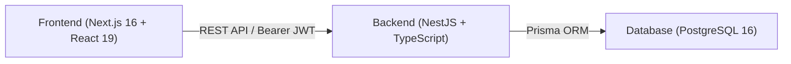

# Agency OS — Sales Pipeline & Deal Management
## Technical Handover Documentation

This document provides architectural context, engineering design decisions, and system blueprints for developers taking over development or maintenance of Agency OS.

---

## 1. System Architecture Overview

Agency OS is built on a clean client-server architecture decoupled via RESTful APIs:

### 1.1 Core Responsibilities
- **Frontend (`/frontend`):**
  - Next.js 16 (App Router) with React 19.
  - Interactive Kanban board using `@dnd-kit/core` and `@dnd-kit/sortable`.
  - Token-based session management (`localStorage` with hydration safety).
  - Clean, responsive UI built with Tailwind CSS v4 and vanilla utility styling.
- **Backend (`/backend`):**
  - NestJS application modularized into domain units (`auth`, `deals`, `pipelines`, `activities`, `follow-ups`, `dashboard`, `handoff`, `probability`, `stalled-detection`).
  - Prisma ORM enforcing schema constraints and relational mappings.
  - Passport JWT strategy with custom decorators (`@CurrentUser`, `@Roles`).
  - Response interceptor wrapping payloads in `{ success: true, data: ..., meta: ... }`.
  - Global `AllExceptionsFilter` providing unified error schemas.

---

## 2. Key Data Models & Relations

The Prisma schema (`backend/prisma/schema.prisma`) implements the following core domain entities:
- **`User`**: System actors with defined `Role` (`ADMIN`, `SALES_REP`, `MANAGER`, `OPERATIONS`).
- **`Client`**: Companies and primary contacts involved in opportunities.
- **`Pipeline` & `PipelineStage`**: Customizable deal lifecycles with stage sequence orders, win flags (`isWon`), and lost flags (`isLost`).
- **`Deal`**: The central entity tracking deal value, currency, close dates, state (`ACTIVE`, `WON`, `LOST`), and relationships.
- **`DealIntelligence`**: Automated health scores and calculated win probabilities based on activity recency and deal size.
- **`Activity`**: Audit trail of stage movements, deal updates, and notes.
- **`FollowUp`**: Actionable tasks with reminder schedules.
- **`ProjectHandoff`**: Transition records created when deals are won for agency operations.

---

## 3. Important Engineering Decisions & Bug Fixes

1. **Hydration & Password Visibility Fix:**
   - Addressed client-side hydration mismatch on the login form by deferring interactive mounting via an `isClient` hook.
   - Refactored password visibility toggle into a cleanly encapsulated client element to prevent browser extension attribute injection errors.
2. **ESLint Strict Typing & Cast Elimination:**
   - Created the explicit `DashboardData` type interface to replace raw `any` casts in `DashboardStats`.
3. **Database & Volume Safety:**
   - Preserved all PostgreSQL migration histories in `backend/prisma/migrations/20261031062345_init/migration.sql` without resetting or dropping volumes.

---

## 4. Known Limitations & Next Steps

1. **Realtime Updates (WebSockets / SSE):**
   - The current Kanban board uses optimistic updates with polling on demand. Adding Socket.io or Server-Sent Events (SSE) will enable real-time multi-user collaboration.
2. **Automated End-to-End Test CI Pipeline:**
   - Playwright configuration exists (`frontend/playwright.config.ts`), but running full headless browser tests in CI requires spinning up a mock PostgreSQL service container.
3. **Multi-Currency Dynamic Conversion:**
   - The dashboard currently groups values by their native currency (`USD`, `EUR`). An exchange-rate API integration would allow unified single-currency rollup reporting.

---

## 5. Developer Quick-Start Guide

To continue development:
1. Ensure Docker Desktop is running and run `docker-compose up -d`.
2. In `backend/`: ensure `.env` matches `.env.example`, run `npx prisma migrate dev`, then `npm run start:dev`.
3. In `frontend/`: ensure `.env.local` exists, then run `npm run dev`.
4. Sign in at `http://localhost:3000` with seeded credentials (`admin@agency-os.local` / `Password123!`).

